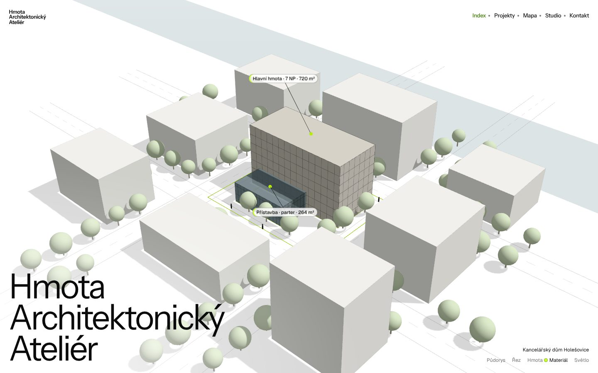
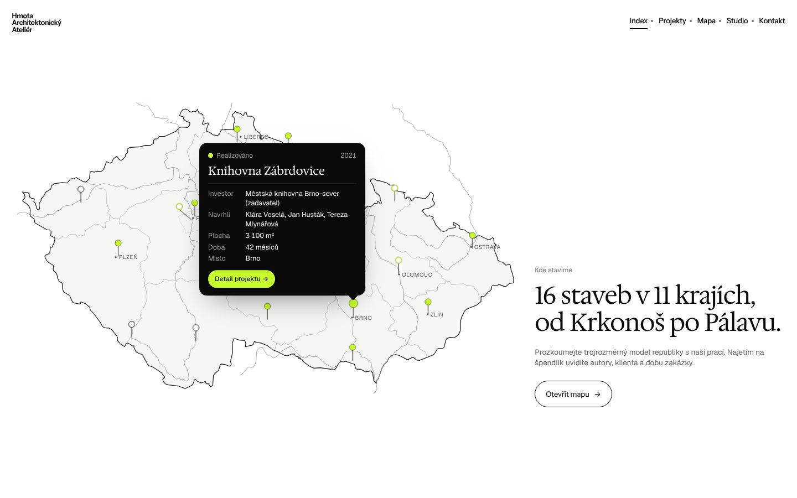
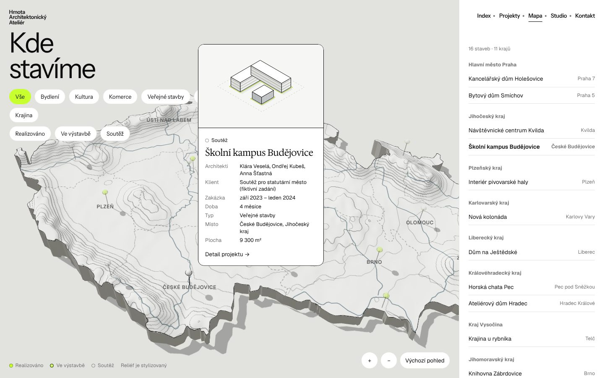
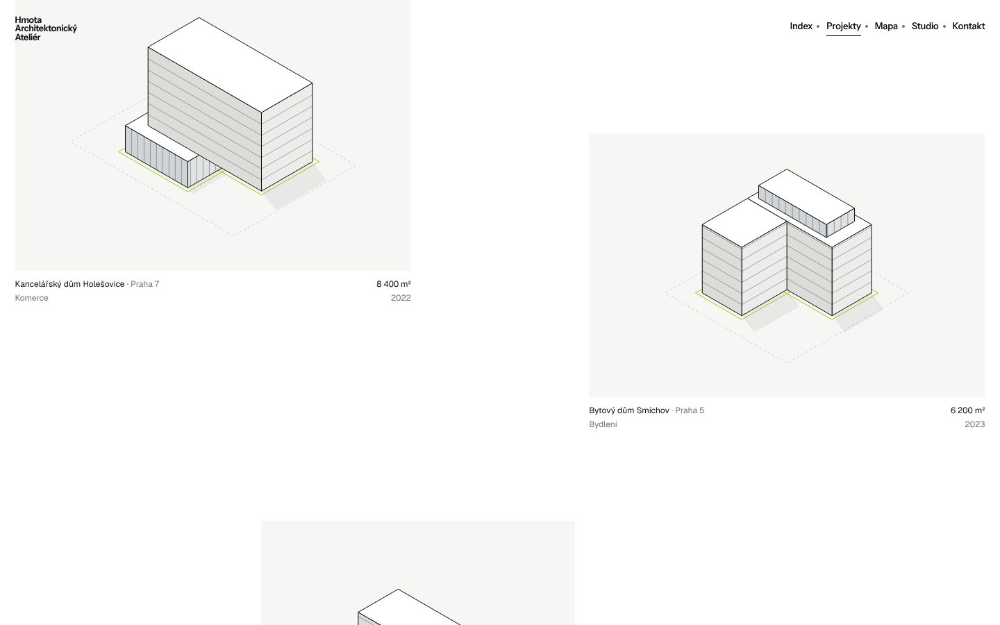
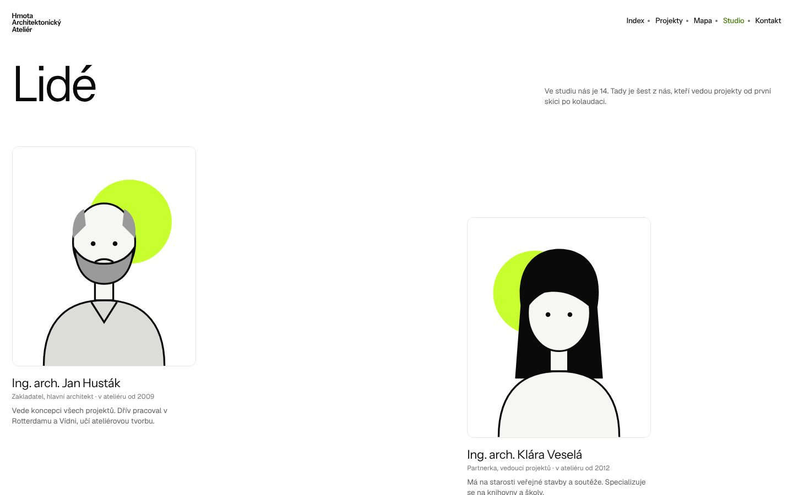
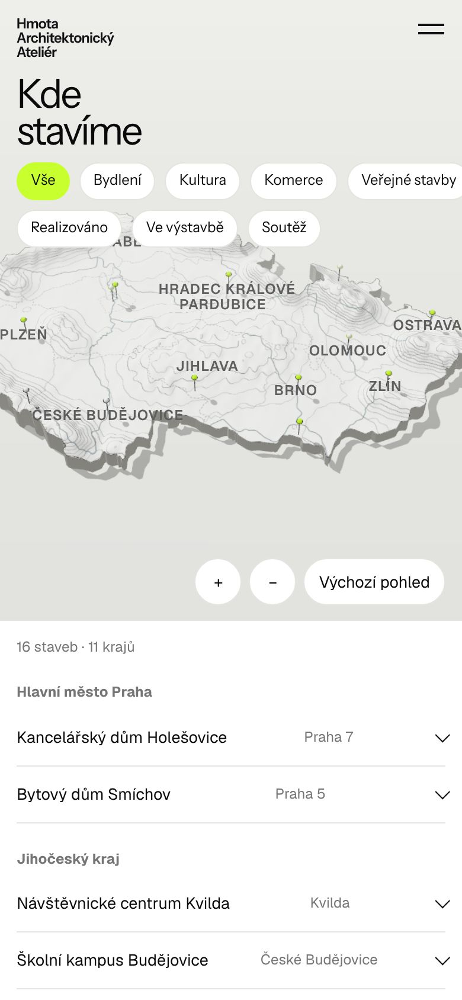
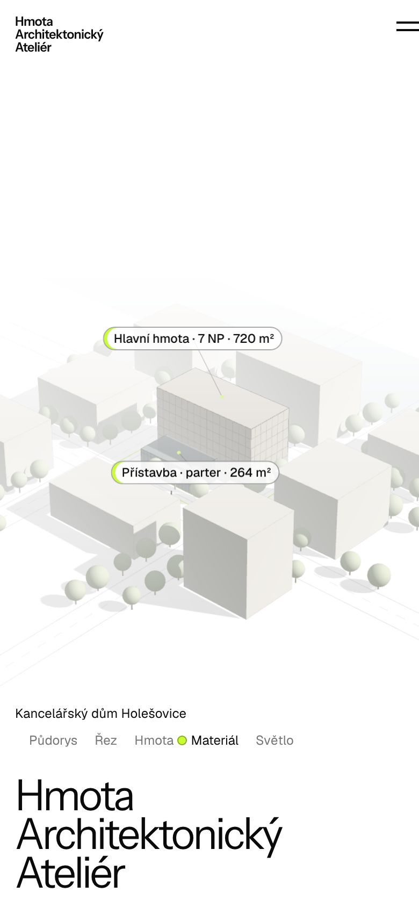
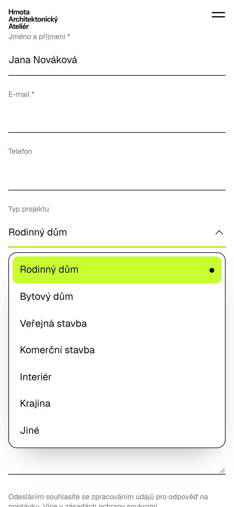

<div align="center">

# HMOTA — Architektonický ateliér

**A building drawn, raised and lit by your scroll. A whole country as a clay site model.**

Demo website for a fictional architectural studio from Prague: a scroll-built 3D model on the landing page, a 3D relief map of the Czech Republic with every project pinned on it, and a calm, type-led design in paper, ink and one electric lime.

[**Open the live site**](https://denysovski.github.io/HMOTA/) &nbsp;·&nbsp; [3D map](https://denysovski.github.io/HMOTA/mapa/) &nbsp;·&nbsp; [Projects](https://denysovski.github.io/HMOTA/projekty/) &nbsp;·&nbsp; [Studio](https://denysovski.github.io/HMOTA/studio/) &nbsp;·&nbsp; [Contact](https://denysovski.github.io/HMOTA/kontakt/)


</div>

> **Demo.** The studio, its people, projects, clients and contact details are invented. The site says so in the footer of every page.

---

## Desktop


**Landing page.** One building drawn by your scroll: plan, section, massing, material and light. Its two volumes carry labels on lines that rise with the building; dimensions in metres show at the start and fade out. Around it: neighbouring blocks, streets, trees and the river.


**Where we build.** Hover a pin on the home-page map: a bubble opens with the investor, the architects, the area and how long the job took.


**3D map.** A clay relief of Czechia with regions, rivers and cities. Every project is a round pin; hovering a pin or a row in the list opens its card, and a click flies the camera to the site.


**Projects.** A scattered grid of axonometric drawings, with filters by type and status that animate in and out.


**Studio.** The team as abstract portraits, with roles and a short note on each person.

## Mobile

<br>
**3D map.** Zoomed out to fit the whole country. Tapping a project in the list unfolds its details; tapping a pin opens a sheet from the bottom.

<br>
**Landing page.** The model halfway through its build, with the hamburger menu in the corner.

<br>
**Contact form.** Custom dropdowns in the site's colours and a lime line that slides to the field you are typing in.

---

## What's inside

- **Scroll-built 3D model** (landing page): plan → section → massing → material → light, with callout labels that follow the building, dimensions at the start, streets, trees, people for scale and a sun moving from 7:00 to 19:00.
- **3D map of Czechia** (`/mapa`): relief, contour lines, regions, rivers and cities; round pins for built, under construction and competition projects; hover cards, camera flights, URL filters, a loading screen and an accessible project list.
- **Projects and project pages**: grid or list, filters, facts table (investor, architects, dates, duration, area), locator map, project text and drawings.
- **Studio, contact, imprint, privacy and 404**: team portraits, enquiry form with custom selects, full imprint with company details.
- **Smooth everywhere**: page transitions that start at the top, line-by-line text reveals, a hamburger menu on phones. Everything respects reduced motion.

## How it was made

Made with **XSlop**, from a researched design brief ([`docs/PROMPT.md`](docs/PROMPT.md)) and the decisions record ([`proui/DECISIONS.md`](proui/DECISIONS.md)). The look follows Kononenko Architectural Bureau: a monochrome page, giant grotesk headlines, serif statements and a scattered project grid.

- **Fonts:** Instrument Sans for headlines (the closest free match to PP Neue Montreal), Hedvig Letters Serif for statements, Geist for small text and numbers.
- **Stack:** Next.js 16, React 19, TypeScript, three.js with React Three Fiber, GSAP and Lenis, d3-geo, zod.
- **Data:** every project lives once in `src/content/projects.ts`; the pins, cards, list, pages and sitemap all come from it. Map data from Natural Earth (public domain); the relief is stylised.
- **Quality:** lint, type checks, tests, build and Lighthouse run on every push. Pushing to `main` deploys the site to GitHub Pages.

## Run it

```bash
npm install
npm run dev            # http://localhost:3000
npm run check          # lint, types, tests and production build
npm run build:pages    # static export for GitHub Pages
```

## About this repository

**Description:** Demo website for an architectural studio: a scroll-built 3D model and a 3D map of the Czech Republic. Next.js, React Three Fiber, GSAP. Made with XSlop.

**Topics:** `architecture` `portfolio` `nextjs` `react-three-fiber` `threejs` `webgl` `gsap` `lenis` `3d-map` `scrollytelling` `czech-republic` `typescript` `github-pages` `xslop`

---

<div align="center"><sub>Demo site, made with XSlop. All studio details are fictional. Map data © Natural Earth.</sub></div>
